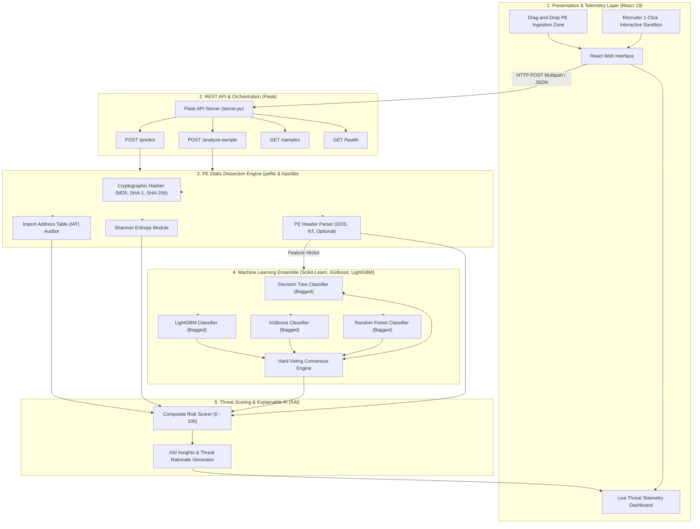

# 🛡️ Sentinel Wraith: Technical Architecture & Detection Methodology

**Author:** Sanjeev Varma  
**Platform:** Sentinel Wraith AI Malware Detection System  
**Version:** 2.1.0  

---

## 1. System Overview & Engineering Philosophy

**Sentinel Wraith** is an autonomous, high-throughput static malware detection platform designed to analyze Windows Portable Executable (`.exe`, `.dll`, `.sys`) binaries.

### The Problem with Traditional Detection
1. **Signature-Based Detection (Hash Blacklists):** Fails against polymorphic and metamorphic malware that mutate code structures, compiler flags, or paddings on every release to alter MD5/SHA-256 hashes.
2. **Dynamic Sandbox Execution:** Heavyweight virtual machine emulation introduces significant latency (often 3 to 10 minutes per file), high compute costs, and vulnerability to **sandbox evasion** (e.g. malware checking `IsDebuggerPresent`, testing for mouse movements, or executing `Sleep(60000)` before running malicious payloads).

### Sentinel Wraith's Zero-Execution Static Approach
Sentinel Wraith performs **deep static analysis** in **under 250 milliseconds**:
* **Zero Host Contamination Risk:** The binary is analyzed purely as a structured byte sequence. No machine code is ever executed.
* **Structural Feature Extraction:** Evaluates DOS header fields, section table layouts, and PE Optional headers.
* **Information Entropy Scanning:** Quantifies randomness to detect encryption, compression, and runtime packing.
* **IAT Behavioral Profiling:** Audits imported API symbols against known MITRE ATT&CK adversarial techniques.
* **Multi-Model ML Ensembling:** Aggregates predictions across four distinct classifiers using Bagging and Hard Voting for robust generalization.

---

## 2. System Architecture & Component Breakdown

---

## 3. How the Detection Engine Works (Step-by-Step)

### Step 1: Ingestion & Cryptographic Fingerprinting
When an executable is uploaded (or a recruiter sample is selected):
1. The raw binary stream is received in-memory and buffered temporarily.
2. The byte stream is processed simultaneously through three hash digests:
   * **MD5** (128-bit)
   * **SHA-1** (160-bit)
   * **SHA-256** (256-bit)
3. Cryptographic fingerprints are stored for auditing and intelligence correlation.

---

### Step 2: PE Header Dissection
Using `pefile`, the binary structure is validated against the Microsoft PE/COFF specification:
* **DOS Header:** Validates the magic bytes (`0x5A4D`, ASCII `"MZ"`). Extracts fields used by the baseline vector:
  * `e_magic`, `e_cblp`, `e_cp`, `e_crlc`, `e_cparhdr`, `e_minalloc`, `e_maxalloc`
* **File Header:**
  * **Machine Type:** Identifies target architecture (`IMAGE_FILE_MACHINE_I386` for 32-bit vs `IMAGE_FILE_MACHINE_AMD64` for 64-bit).
  * **TimeDateStamp:** Extracts original binary compilation timestamp in UTC to flag timestamp anomalies (e.g. future compilation dates or zeroed timestamps common in malware).
  * **NumberOfSections:** Identifies total declared executable and data sections.
* **Optional Header:**
  * **AddressOfEntryPoint:** Hexadecimal RVA (Relative Virtual Address) where execution begins.
  * **ImageBase:** Preferred virtual memory address.
  * **Subsystem:** Determines whether the binary runs as Windows GUI, Console CUI, or Native driver.

---

### Step 3: Shannon Section Entropy & Obfuscation Analysis
Malware authors commonly encrypt shellcode or employ runtime packers (e.g. UPX, Themida, ASPack, MPRESS) so that signature scanners cannot find plain-text strings or recognizable byte sequences.

Sentinel Wraith mathematically calculates the **Shannon Entropy** ($H$) of each section:

$$H(X) = - \sum_{i=0}^{255} p(x_i) \log_2 p(x_i)$$

Where:
* $p(x_i)$ is the probability of occurrence of byte value $i$ ($0x00$ to $0xFF$) in the section buffer.
* The entropy result ranges from **$0.0$** (completely uniform/redundant bytes, e.g. all nulls) to **$8.0$** (completely random, unpredictable byte distribution).

#### Threat Thresholds:
* **$H < 5.5$:** Standard plaintext data or normal compiled executable code.
* **$5.5 \le H \le 7.0$:** Compressed program assets or dense code.
* **$H > 7.0$:** **High Entropy / Weaponized Obfuscation.** Strongly indicates encrypted payloads, obfuscated shellcode, or packed binaries.
* **Packer Signatures:** Section names are also checked against known packer signatures (`UPX0`, `UPX1`, `.aspack`, `.themida`, `.vmp`, `.mpress`).

---

### Step 4: Import Address Table (IAT) Audit & MITRE ATT&CK Mapping
The binary's `DIRECTORY_ENTRY_IMPORT` table is audited to discover all dynamically linked Windows APIs. Sentinel Wraith maps detected APIs into critical threat categories:

| Threat Category | Flagged APIs | Adversarial Purpose |
| :--- | :--- | :--- |
| **Process Injection & Memory Tampering** | `VirtualAllocEx`, `WriteProcessMemory`, `CreateRemoteThread`, `QueueUserAPC`, `NtMapViewOfSection`, `VirtualProtect` | Injecting shellcode into legitimate processes (e.g. `svchost.exe`, `explorer.exe`) to execute stealthily. |
| **Anti-Analysis & Evasion** | `IsDebuggerPresent`, `CheckRemoteDebuggerPresent`, `OutputDebugStringA`, `FindWindowA`, `Sleep` | Detecting debuggers, sandboxes, and virtual machines to abort execution before analysis. |
| **Persistence & Privilege Escalation** | `RegCreateKeyExA`, `RegSetValueExA`, `AdjustTokenPrivileges`, `OpenProcessToken` | Adding `Run` keys to Windows Registry or acquiring `SeDebugPrivilege` to compromise OS core. |
| **Command & Control / Networking** | `URLDownloadToFileA`, `InternetOpenA`, `HttpSendRequestA`, `WSAStartup`, `socket` | Communicating with remote C2 servers to beacon infected status or download second-stage malware payloads. |
| **Execution & Process Spawning** | `WinExec`, `ShellExecuteA`, `CreateProcessA`, `CreateProcessW` | Spawning command prompts (`cmd.exe`, `powershell.exe`) or executing dropped payloads. |

#### High-Risk Weaponized Chains:
* **Process Hollowing Chain:** Detection of `VirtualAllocEx` + `WriteProcessMemory` + `CreateRemoteThread`.
* **Dropper/Downloader Chain:** Detection of `URLDownloadToFileA` / `InternetReadFile` paired with `WinExec` / `CreateProcess`.

---

### Step 5: Multi-Model Machine Learning Ensemble
Sentinel Wraith executes a stacked ensemble trained on **19,613 PE binaries** from the BODMAS and VirusShare datasets:

1. **Decision Tree (Bagged):** Fast hierarchical decision boundaries.
2. **Random Forest (Bagged):** Forest of 100 de-correlated trees providing low-variance baselines.
3. **XGBoost (Bagged):** Gradient-boosted decision trees optimizing loss functions with $L_1$ (`reg_alpha`) and $L_2$ (`reg_lambda`) regularization.
4. **LightGBM (Bagged):** Fast, leaf-wise gradient boosting capable of capturing non-linear interactions across PE header fields.

#### Consensus Engine:
The ensemble executes **Hard Voting**:
$$\hat{y} = \text{mode}\left(C_1(x), C_2(x), C_3(x), C_4(x)\right)$$
* Each model votes: `1` (Malicious) or `0` (Benign).
* **Consensus Percentage** is calculated:
  $$\text{Consensus} = \left(\frac{\sum \text{Malicious Votes}}{\text{Total Models}}\right) \times 100\%$$
* If 4 out of 4 models agree, consensus is **100%**.

---

### Step 6: Composite Risk Scoring & Explainable AI (XAI)
To avoid black-box opacity, Sentinel Wraith fuses all signals into a transparent **Composite Threat Score ($0 - 100$)**:

$$\text{Threat Score} = S_{\text{ML}} + S_{\text{Entropy}} + S_{\text{APIs}} + S_{\text{Anomalies}}$$

Where:
* **$S_{\text{ML}}$ (Up to 30 pts):** Proportional to ensemble voting consensus.
* **$S_{\text{Entropy}}$ (Up to 35 pts):** Awarded for high section entropy ($> 7.2$) or confirmed packer signatures.
* **$S_{\text{APIs}}$ (Up to 35 pts):** Awarded for weaponized injection chains (+35), dropper chains (+30), or multiple dual-use APIs (+15).
* **$S_{\text{Anomalies}}$ (Up to 5 pts):** Structural anomalies (e.g. entrypoint 0 or invalid section sizes).

#### Final Threat Levels:
* **$65 - 100$:** 🔴 **MALICIOUS / HIGH RISK** (Critical Threat)
* **$40 - 64$:** 🟡 **SUSPICIOUS** (Elevated Risk)
* **$0 - 39$:** 🟢 **CLEAN / BENIGN** (Low Risk)

#### Explainable AI (XAI) Output:
The engine generates clear natural-language rationale explaining *why* the verdict was reached (e.g. *"AI Ensemble Model: 4 of 4 models flagged potential threat patterns (100.0% consensus)"*, *"Detected Process Injection API chain: VirtualAllocEx / WriteProcessMemory / CreateRemoteThread"*).

---

## 4. Technology Stack Summary

| Layer | Technologies |
| :--- | :--- |
| **Frontend Web Client** | React 19, Tailwind CSS v3, Lucide React Icons, React Router v7, Axios |
| **Backend REST Service** | Python 3.9+, Flask, Flask-CORS, Gunicorn |
| **Static Binary Analysis** | `pefile`, `hashlib`, Python standard `math` & `datetime` |
| **Machine Learning** | `scikit-learn`, `xgboost`, `lightgbm`, `catboost`, `joblib`, `numpy`, `pandas` |
| **Dataset & Research** | BODMAS Malware Dataset, VirusShare PE Collection (19,613 samples), SMOTE, PCA |

---

## 5. Summary & Portfolio Value

Sentinel Wraith bridges the gap between **academic machine learning** and **practical cybersecurity engineering**. By uniting mathematical entropy analysis, MITRE ATT&CK heuristic inspection, and a 4-classifier ML voting ensemble, it delivers a transparent, auditable, and resilient malware detection system.
