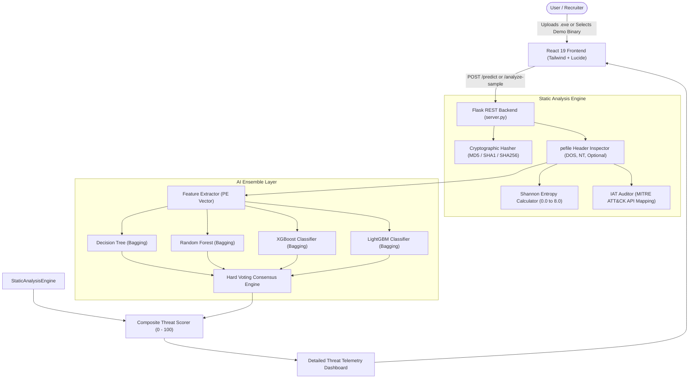

<p align="center">
  
</p>

<h1 align="center">🛡️ Sentinel Wraith: AI-Powered PE Malware Detection Platform</h1>

<p align="center">
  <strong>Next-Generation Static Threat Intelligence via Stacked Machine Learning Ensembles</strong>
</p>

<p align="center">
  
  
  
  
  
  
</p>

---

## 📌 Executive Overview

**Sentinel Wraith** is an autonomous malware detection and static analysis framework for Windows Portable Executable (`.exe`, `.dll`) binaries. 

Unlike signature-based antiviruses that fail against polymorphic 0-days, or dynamic sandboxes that take minutes to run and risk host contamination, **Sentinel Wraith executes deep static dissection in under 250 milliseconds**:
- **Zero Host Risk**: Operates strictly via static byte parsing with zero binary execution.
- **Shannon Section Entropy**: Detects obfuscated, encrypted, and packed shellcode (UPX, Themida, ASPack).
- **MITRE ATT&CK Mapping**: Identifies dangerous dual-use APIs for process injection, anti-debugging, and C2 communication.
- **Ensemble Consensus**: Aggregates predictions across Decision Trees, Random Forests, XGBoost, and LightGBM with explainable confidence scoring.
- **Recruiter 1-Click Sandbox**: Built-in test binaries enabling instant live testing on any OS without requiring a local `.exe`.

---

## 🏗️ Architecture & Pipeline



---

## 🚀 Key Features

### 1. 🧠 Multi-Model Bagging & Voting Ensemble
* Combines predictions from **DecisionTree**, **RandomForest**, **XGBoost**, and **LightGBM**.
* Employs **Bootstrap Aggregating (Bagging)** on each estimator to minimize variance and combat overfitting.
* Out-of-fold probability distribution aggregation via **Stacked Generalization** with a LightGBM meta-learner.

### 2. 🔬 Deep PE Binary Dissection
* **Shannon Entropy Analysis**: Computes mathematical entropy ($H(X) = -\sum p(x) \log_2 p(x)$) per section (`.text`, `.rdata`, `.data`, `.rsrc`). Entropy exceeding 7.0 automatically flags packed payloads.
* **Import Address Table (IAT) Inspection**: Matches functions against a catalog of MITRE ATT&CK malware techniques:
  * *Process Injection*: `VirtualAllocEx`, `WriteProcessMemory`, `CreateRemoteThread`, `QueueUserAPC`.
  * *Anti-Analysis / Evasion*: `IsDebuggerPresent`, `CheckRemoteDebuggerPresent`, `OutputDebugStringA`.
  * *Privilege Escalation*: `AdjustTokenPrivileges`, `OpenProcessToken`.
  * *Command & Control*: `URLDownloadToFileA`, `InternetOpenA`, `HttpSendRequestA`.

### 3. 🎯 Recruiter 1-Click Interactive Sandbox
* Pre-loaded with curated sample binaries (`Palo Alto WildFire PE`, `7-Zip Setup`, `Greenshot Installer`, `System Diagnostics`).
* Recruiters on macOS, Linux, or mobile can evaluate live static analysis with one click.

---

## 📁 Repository Structure

```
├── backend/
│   ├── api/
│   │   ├── server.py                     # High-performance Flask REST API & static analysis engine
│   │   ├── bagging_voting_ensemble.joblib # Trained 4-model ensemble artifact
│   │   └── requirements.txt              # Backend dependencies
│   ├── model/
│   │   ├── advanced_stacked_ensemble.joblib # Stacked generalization model
│   │   ├── model.pkl & scaler.pkl        # Baseline Random Forest & Scaler
│   ├── test/                             # Benchmark binaries (WildFire, 7-Zip, Greenshot)
│   └── training/
│       ├── malware_dataset.csv           # BODMAS & VirusShare training dataset (19,613 records)
│       └── train_model.py                # Standalone training pipeline
│
├── frontend/app/
│   ├── src/
│   │   ├── components/
│   │   │   ├── Header.jsx                # Futuristic navigation & live engine status indicator
│   │   │   ├── MalwareUpload.jsx         # Telemetry dashboard, entropy table, & 1-click test runner
│   │   │   ├── Cards.jsx                 # Interactive 4-phase workflow breakdown
│   │   │   ├── About.jsx                 # Research documentation & architecture whitepaper
│   │   │   └── Footer.jsx                # Engineering credits & license
│   │   ├── pages/
│   │   │   └── Home.jsx                  # Hero landing page, stats matrix, & demo triggers
│   │   └── index.css                     # Cyber grid & glassmorphism styling
│   └── package.json
│
├── model/
│   └── Malware_detection_with_machine_learning.ipynb # Complete research notebook (EDA, SMOTE, PCA, Stacking)
└── README.md
```

---

## ⚡ Quickstart Guide

### 1. Prerequisites
- **Python 3.9+**
- **Node.js 18+** & npm
- macOS users: `brew install libomp` (for OpenMP runtime used by XGBoost)

### 2. Backend Setup
```bash
# Navigate to backend and create virtual environment
cd backend
python3 -m venv venv
source venv/bin/activate

# Install dependencies
pip install flask flask-cors pefile joblib scikit-learn numpy xgboost lightgbm

# Start the Flask API server
python api/server.py
```
> The API server will listen on `http://localhost:5000`.

### 3. Frontend Setup
```bash
# In a new terminal, navigate to the frontend app
cd frontend/app

# Install dependencies
npm install --legacy-peer-deps

# Start the React development server
npm start
```
> The web interface will open automatically on `http://localhost:3000`.

---

## 📡 REST API Reference

### `GET /health`
Returns active model state, version, and loaded estimators.
```json
{
  "status": "online",
  "service": "Sentinel Wraith Malware Detection Engine",
  "version": "2.1.0",
  "active_models": [
    "DecisionTreeClassifier (Bagging)",
    "RandomForestClassifier (Bagging)",
    "XGBClassifier (Bagging)",
    "LGBMClassifier (Bagging)"
  ]
}
```

### `GET /samples`
Returns the catalog of pre-loaded demonstration binaries.

### `POST /analyze-sample`
Runs full static analysis on a pre-loaded sample binary by ID.
```json
// Request
{ "sample_id": "wildfire-test" }

// Response includes threat score, hashes, section entropy, ML votes, and API mappings
```

### `POST /compare`
Generates a side-by-side forensic benchmark diff between any two binary samples.
```json
// Request
{ "sample_a": "7zip-installer", "sample_b": "wildfire-test" }

// Returns side-by-side comparison of threat scores, W^X compliance, entropy, and ML consensus
```

### `POST /predict` or `POST /analyze`
Uploads a user-provided PE executable (or JSON sample payload) for immediate analysis.
* **Body**: `multipart/form-data` with `file: <binary.exe>` or JSON `{ "sample_id": "<id>" }`

---

## 👨‍💻 Project Author
 
* **Sanjeev Varma** — *Lead Cybersecurity & Machine Learning Engineer*

---

## 📝 License

Distributed under the MIT License. See [LICENSE](LICENSE) for more information.
